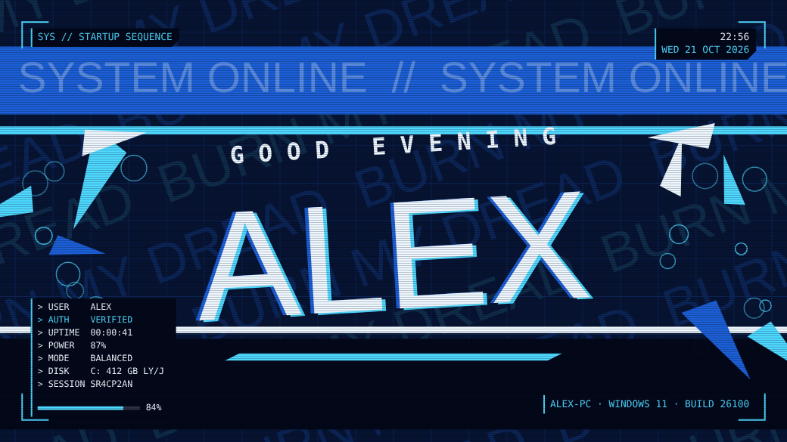
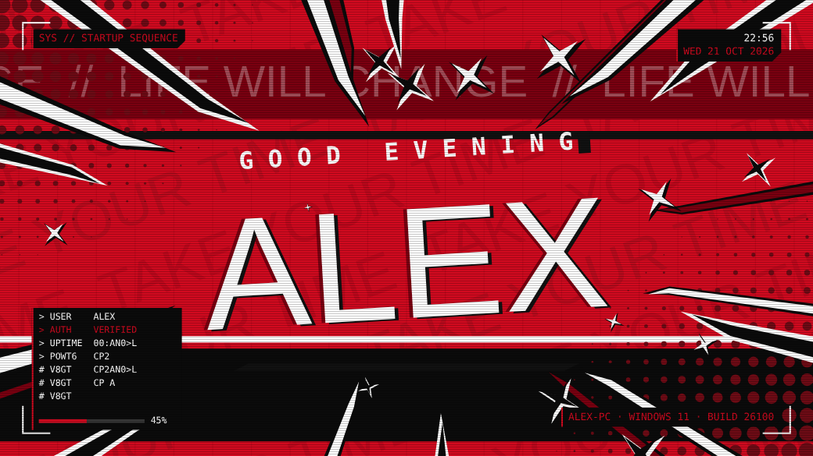
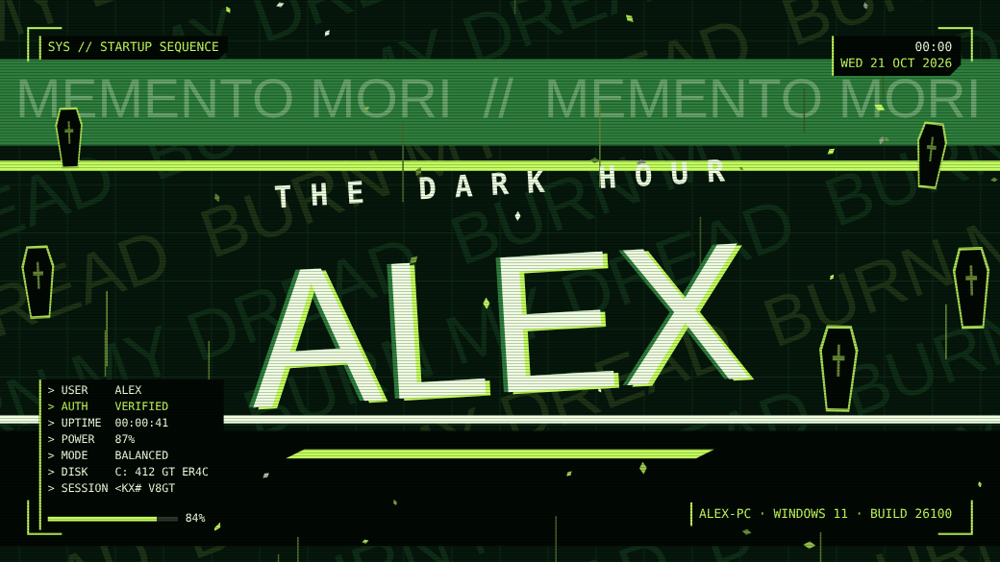
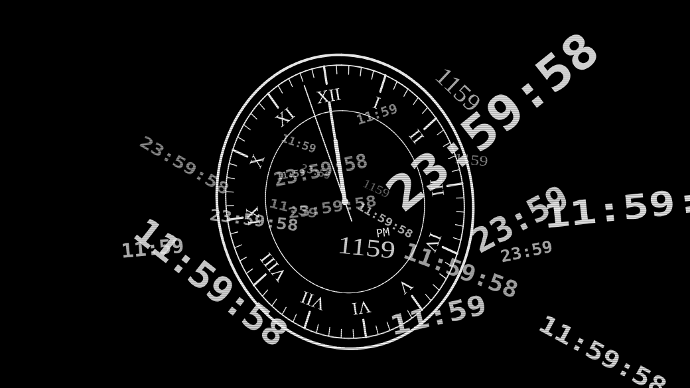
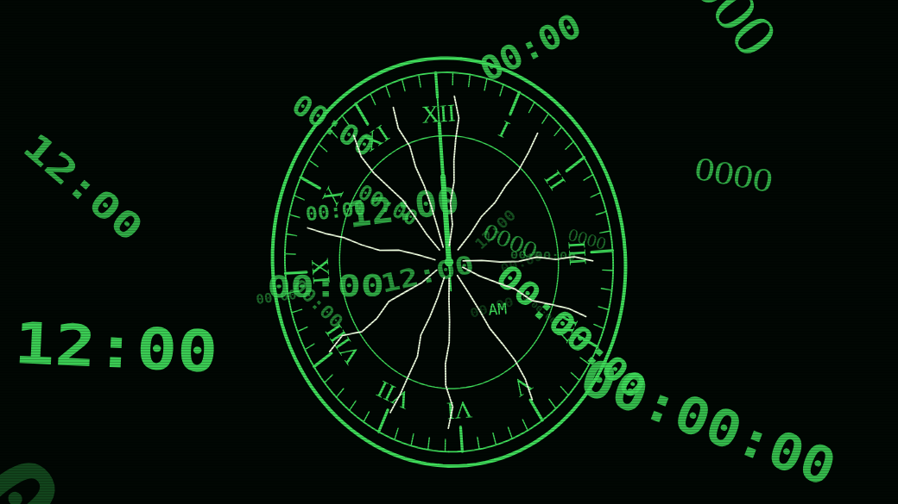

# Persona Boot Splash

A full-screen "Welcome back" animation for Windows that plays the moment you sign in, styled after the Persona 3 Reload and Persona 5 menus. Diagonal slashes cut across the screen, the name slams in with a glitch, a system readout types itself out, and blades slice open onto your desktop. It runs for 3 seconds and any key or click skips it.

## Modes

| Mode | Look |
| --- | --- |
| **Normal** | Persona 3 blue. Rising bubble rings at the sides, cyan shards, "BURN MY DREAD" rows rushing in the background, and a rotating band phrase. |
| **Persona 5** | Red, black and white. Streaks shoot in from the screen edges into sharp speech-bubble points, with sparkle stars, halftone corners and a hard black-then-white impact flash. |
| **Dark Hour** | An easter egg. A midnight clock ticks over to 12:00, everything turns green, then the clock cracks and shatters into a green splash with rising coffins and embers. It adds 3 seconds. |
| **Auto** (default) | Normal, except that it switches to Dark Hour if you sign in between 00:00 and 01:00. |

| Persona 5 | Dark Hour |
| --- | --- |
|  |  |
|  |  |

## What it shows

- A greeting based on the time of day: GOOD MORNING, GOOD AFTERNOON or GOOD EVENING.
- Your PC name, Windows version and build, uptime, battery, Windows power mode and free disk space, read live at startup.
- The current time and date.

## Requirements

- Windows 10 or 11
- Python 3.10 or later. [Thonny](https://thonny.org)'s bundled Python works, and so does a normal python.org install.
- [pygame-ce](https://pypi.org/project/pygame-ce/), installed by `setup/Install pygame.cmd`

## Setup

1. Download or clone this repo and keep the folder somewhere permanent, such as `Documents\persona-boot-splash`.
2. Double-click **`setup/Install pygame.cmd`** to install pygame-ce. You only need to do this once.
3. Double-click **`launchers/Boot Splash.vbs`** to check it plays.
4. Double-click **`setup/Start splash at sign-in.cmd`**. This adds a Task Scheduler task that starts the splash as soon as you sign in. If it asks for administrator rights, right-click it and choose **Run as administrator**.

Sign out and back in to see it.

## Everyday use

| File | What it does |
| --- | --- |
| `launchers/Boot Splash.vbs` | Plays the splash now |
| `launchers/Switch Splash Mode.vbs` | Cycles Auto → Dark Hour → Persona 5 → Normal. Press Enter in the popup to preview the mode. |
| `launchers/Test Splash.cmd` | Plays the splash with a console window that shows any errors |
| `setup/Remove sign-in splash.cmd` | Stops it running at sign-in |

You can also pick a mode for a single run: `pythonw src/boot_animation.pyw --dark` (or `--p5`, `--normal`, `--auto`).

## Preview without installing

Open `preview/index.html` in a browser. It plays every mode with a Replay button and mode switches. The browser fonts differ slightly from the Windows ones: Impact, Consolas and Times New Roman.

## How it works

- **`src/boot_animation.pyw`** draws everything with pygame. Big animated text is rendered once and then scaled and faded as an image, and faint background text uses fast transparent blits, so it holds 60 fps or more at 1080p. Screens above 1920×1200 render at about 1080p detail and are scaled up smoothly.
- **Sign-in timing.** The Startup folder only runs apps after the desktop has loaded, and Windows adds a delay on top. The scheduled task starts the splash immediately instead. The splash covers the screen in black, waits until the taskbar exists and the desktop is ready, then plays and stays on top while Windows finishes loading.
- **Desktop reveal.** The window is a Windows layered window with a colour key, so when the blades slice open you see your real desktop underneath.
- **Settings and logs.** The chosen mode is saved in `src/splash_mode.txt`. Any error is written to `src/splash_error.log`, because the windowless `pythonw` has no console to print to.

## Troubleshooting

- **Nothing plays at sign-in.** Run `launchers/Test Splash.cmd` and read the error, or check `src/splash_error.log`.
- **It shows the desktop first.** Make sure you're using the sign-in task and not a shortcut in the Startup folder. Remove any Startup copy so it doesn't run twice.
- **`No module named pygame`.** Run `setup/Install pygame.cmd` again, for example after reinstalling Python or Thonny.

## Disclaimer

This is a fan-made project and isn't affiliated with or endorsed by ATLUS or SEGA. Persona is a trademark of ATLUS. The phrases used are short nods to the games, and no game assets are included.
